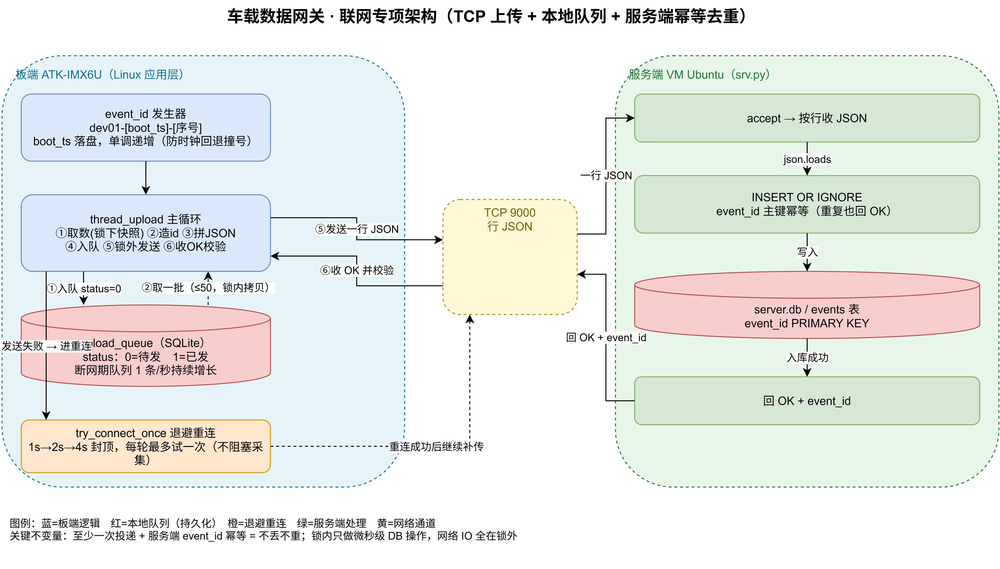

# 车载数据网关 · 联网专项（TCP → 帧协议 → 断网补传）

> 嵌入式 Linux 应用层网络编程实战项目（2026-10-25 ~ 2026-11-09）
> 目标：把"传感器记录仪"升级成"能上报的网关"——设备端 TCP 上传 + 服务端落库去重 + 断网不丢数据。

---

## 一、这个项目做了什么

| 阶段 | 周 | 内容 | 产出 |
|---|---|---|---|
| 0 TCP 入门 | W1-W3 | 阻塞版 echo → select → poll → epoll(LT) | 四版服务端，3 客户端并发验证 |
| 1 帧与重连 | W4-W5 | 4 字节长度前缀帧 + read_full/write_full；SIGPIPE、指数退避、心跳 | `frame.c`、`net_reconnect.c` |
| 2 网关上半场 | W6-W7 | Python 服务端（event_id 幂等去重）+ 板上 uploader | `srv.py`、`event_id.c`、`thread_upload.c` |
| 3 断网补传 | W8-W9 | SQLite 本地队列 + 批量补传 + 三组异常注入 | `db_upload.c` + 三组实验数据 |

**核心结论**：至少一次投递 + 服务端幂等 = 不丢不重。

---

## 二、架构



```
板端(ATK-IMX6U)                                        服务端(VM Ubuntu)
┌─────────────────────────────┐          ┌──────────────────────────────┐
│ event_id 发生器              │          │ srv.py                       │
│   dev01-<boot_ts>-<seq>     │          │  accept → 按行收 JSON         │
│        ↓                    │   TCP    │        ↓                     │
│ thread_upload 主循环         │  9000    │  INSERT OR IGNORE            │
│  ① 取数(锁下快照)            │ ←──────→ │  (event_id 主键幂等)          │
│  ② 造 id → ③ 拼 JSON        │  行JSON  │        ↓                     │
│  ④ 入队 upload_queue(SQLite)│          │  server.db / events 表        │
│  ⑤ 锁外发送 → ⑥ 收 OK       │          │        ↓                     │
│  ⑦ 失败留 0，下轮重发        │          │  回 "OK <event_id>"           │
└─────────────────────────────┘          └──────────────────────────────┘
   断网期：队列 1 条/秒持续增长（不阻塞采集）
   恢复后：50 条/批批量补传；重连退避 1s→2s→4s 封顶
```

---

## 三、协议（行 JSON over TCP 9000）

**上行**（设备 → 服务端，一行一条）：

```json
{"device":"dev01","event_id":"dev01-1794229160-000123","ts":1794229283,"temp":25.5,"hum":60.1,"ax":0.98,"alert":null}
```

| 字段 | 类型 | 说明 |
|---|---|---|
| device | string | 设备号，固定 `dev01` |
| event_id | string | `dev01-<boot_ts>-<6位序号>`，**跨重启唯一**（幂等键） |
| ts | int | 采集时间戳（秒） |
| temp / hum | real | 温度 ℃ / 湿度 %RH |
| ax | real | 合加速度 g |
| alert | string/null | 事件类型或 null |

**下行**（服务端 → 设备）：

```
OK <event_id>\n
```

设备收到且校验 `event_id` 一致才把队列行置为已发（`status=1`）。

**帧格式（二进制通道）**：`[4B 大端长度][payload]`，长度用 `htonl/ntohl`，即 `frame.c` 的 `send_frame/recv_frame`。

---

## 四、可靠性设计

| 机制 | 实现 | 说明 |
|---|---|---|
| **本地队列** | `upload_queue(id, event_id UNIQUE, payload, status, retries, created_at)` | 先落库再发送；`status` 只有 0/1，断电不卡中间态 |
| **至少一次** | 收到 `OK <event_id>` 才置 1；失败保持 0 下轮重发 | 宁可重发，不可漏发 |
| **幂等去重** | 服务端 `event_id` 主键 + `INSERT OR IGNORE` | 重复投递被主键吸收，仍然回 OK |
| **锁外网络 IO** | 锁内只做 SELECT 拷数据 / 单条 UPDATE；send/recv 全在锁外 | 网络阻塞数秒不能占用 `g_db_lock`，否则采集线程丢帧 |
| **非阻塞重连** | `try_connect_once` 每轮最多试一次，退避 1s→2s→4s 封顶 | 断网期采集不中断，队列持续增长 |
| **event_id 单调** | boot_ts 落盘 `/home/root/.event_boot_ts`，启动取 `max(now,last+1)` | 防 RTC 时钟回退导致撞号丢数据 |

---

## 五、实验数据（三组异常注入）

| # | 场景 | 注入方式 | 积压 | 补传结果 | 重复 |
|---|---|---|---|---|---|
| 1 | 服务端崩溃 | kill srv.py 约 50s | ~50 条 | 指数退避后自动重连补齐 | 0 |
| 2 | 设备断电 | 暴力拔电 | 断电前残留 1 条 | 重启后续传成功，`event_id` 不撞号 | 0 |
| 3 | 长断网 | 断服务端约 2 分钟 | **128 条** | **50 条/批，数秒补完** | 0 |

**按代对账（8 代全部精确闭合）**：

```sql
-- 板端
SELECT substr(event_id,7,10), COUNT(*) FROM upload_queue GROUP BY 1;
-- 服务端
SELECT substr(event_id,7,10), COUNT(*) FROM events GROUP BY 1;
-- 判据：每一代 板行数 = 服务端条数（±1 在途）
```

**实测样例**：代 `1794229160` 板 236 = 服务端 236；代 `1794228327` 板 313 = 服务端 313。

---

## 六、目录

```
net_gateway/
├── README.md
├── docs/
│   ├── protocol.md        # 协议字段表
│   └── arch.png           # 架构图（drawio 导出）
├── srv.py                 # Python 服务端（按行收 JSON + 幂等落 SQLite）
├── main_test.c            # 最小测试版入口（模拟数据 + thread_upload）
├── thread_upload.c/.h     # 上报线程：入队/发送/收OK/断网补传
├── event_id.c/.h          # event_id 发生器（boot_ts 单调递增）
├── db_upload.c/.h         # upload_queue 的 SQLite 操作（锁内）
├── frame.c/.h             # 4B 长度前缀帧编解码 + read_full/write_full
├── net_reconnect.c/.h     # SIGPIPE / 退避重连 / safe_read/write
├── tcp_echo_s.c           # W1 阻塞版服务端
├── tcp_echo_c.c           # W1 客户端
├── tcp_echo_s3.c          # W1 argv 变体
├── tcp_echo_select.c      # W2 select 多客户
├── tcp_echo_poll.c        # W3 poll 版
└── tcp_echo_epoll.c       # W3 epoll LT 版
```

---

## 七、怎么跑

**服务端（VM）**
```bash
python3 srv.py                      # 监听 :9000，落盘 server.db
sqlite3 server.db 'SELECT COUNT(*) FROM events;'
```

**设备端（交叉编译 + 上板）**
```bash
arm-linux-gnueabihf-gcc -std=gnu99 -Wall -Wextra -g \
    -I/usr/local/arm/sqlite3/include \
    main_test.c thread_upload.c event_id.c frame.c net_reconnect.c db_upload.c \
    -L/usr/local/arm/sqlite3/lib -o test_upload_arm -lpthread -lsqlite3
scp -O test_upload_arm root@192.168.1.100:/home/root/
# 板上
./test_upload_arm
```

**断网实验**
```bash
# 杀服务端 → 观察板上队列增长：[up] queue=N 每秒 +1
# 恢复服务端 → 批量补传：[srv] +1 一秒几十条
```

---

## 八、已知边界与后续

- MQTT 通道（QoS1 + LWT 在线检测）为 W11-W12 计划，尚未实现；
- 界面/远程管理不在本仓库范围（见 Qt 仓库）；
- 设备 RTC 无电池，时钟会回退——`event_id` 已用"boot_ts 落盘单调递增"兜底，日志时间戳仍以对时为准。
